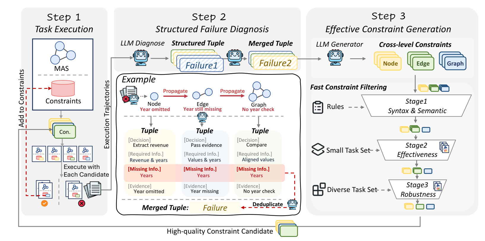

# Harness Optimization for Multi-Agent Systems Across Node, Edge, and Graph

MASH optimizes the harness of a fixed multi-agent system across three execution levels: node-level agent behavior, edge-level information exchange, and graph-level team coordination. It diagnoses failures from recorded execution trajectories, generates executable harness changes, filters candidates against a fixed parent, and freezes the selected harness before test evaluation.


## Method



*MASH executes candidate harnesses, diagnoses failures from trajectory evidence, and generates node-, edge-, and graph-level changes that pass syntax, effectiveness, and robustness checks.*

Each optimization round follows the implementation in `mash/search.py`:

1. Execute the current harness, or evaluate candidates retained from the preceding round against the same fixed parent on matched tasks and seeds.
2. Adopt the candidate with the largest strictly positive normal-evaluation gain. If no candidate improves on the parent, retain the parent unchanged.
3. Diagnose the selected trajectories as D/R/I/M/E records: failed decision, required information, received information, missing information, and trajectory evidence. Diagnoses are merged only when their recorded origins support a shared root cause.
4. Plan and implement candidates around one failure group and one repair hypothesis. A candidate may coordinate changes across node, edge, and graph targets.
5. Filter each candidate through rule-based syntax and semantic checks, paired evaluation on a small diagnosis subset, and paired evaluation on a separate validation set. Passing candidates enter the next round.

The default normalized gain thresholds are `0.005` for Stage 2 and `0.0025` for Stage 3. Parent scores are freshly paired with each candidate; they are not reused across candidates or stages.

## Quick start: Finance

From the repository root, install the package with Python 3.11 or newer and run one Finance fold:

```bash
python -m pip install -e .
python -m examples.finance_quickstart --integration your_project.finance_integration --output outputs/finance-fold-0
```

The original Finance protocol uses 50 tasks and five folds. This command runs one supplied fold while preserving the Finance defaults, exact-match scoring, native Finance hook contracts, and the shared `Store` used for candidate versions and preflight feedback.

The integration module exports `runner`, `tasks`, `split`, `runtime_context`, and `make_optimizer_client`. The runner exposes `system_id`, `exposed_targets`, and `execute`; `tasks` is a tuple of `Task`; `split` is one Finance `TaskSplit`; `runtime_context` describes each exposed hook's native invocation, inputs, and outputs; and `make_optimizer_client(store)` returns a client with `store` and `complete(...)`. The command prints the frozen harness JSON. 

## Core files

- `mash/models.py`: tasks, trajectories, structured diagnoses, merge claims, repair plans, candidates, paired results, and frozen harnesses.
- `mash/diagnosis.py`: evidence validation, causal-path checks, and shared-root-cause organization.
- `mash/optimizer.py`: diagnosis, planning, implementation, and revision prompts together with `LLMOptimizer`.
- `mash/evidence.py`: bounded access to current, historical, paired-parent, and screening evidence.
- `mash/hooks.py`: editable target registry, restricted hook language, Stage 1 checks, behavior cases, and host contracts.
- `mash/finance_contracts.py`: concrete host invariants for plans, handoffs, evidence bindings, retries, orchestration, and tool transitions.
- `mash/api.py`: validation of the invocation, input, output, and native-consumer semantics supplied for every exposed target.
- `mash/evaluation.py` and `mash/search.py`: paired execution, the three filtering stages, adoption, and final freezing.
- `mash/feedback.py` and `mash/effects.py`: repair effects, mechanism activation, rejection context, and historical feedback.
- `mash/trace.py`: execution events and information-flow links consumed by diagnosis and hook integration.
- `mash/storage.py`: candidate version registration and preflight-rejection records used by later feedback.
